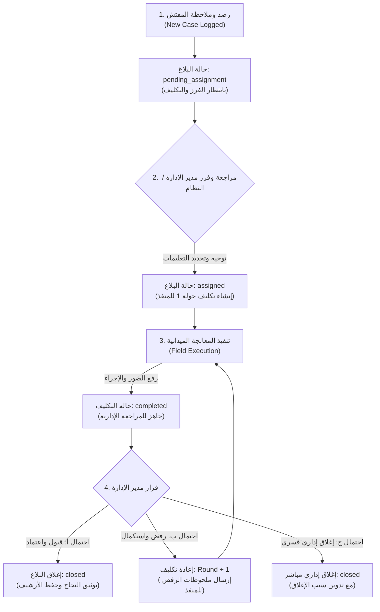
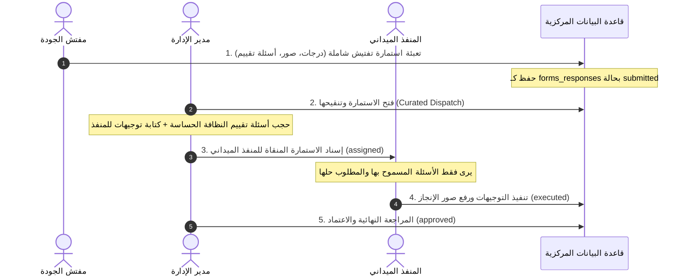

# الدليل الشامل لمنظومة حوكمة الجودة والبلاغات التصحيحية (CAPA V2)
### مطعم المراسيم | Al-Marasim Restaurant

---

## 1. الرؤية المعمارية للمنظومة (System Architecture)

صُممت المنظومة لتطبيق مفهوم **CAPA** (Corrective and Preventive Actions - الإجراءات التصحيحية والوقائية) في بيئة المطاعم الراقية وسلاسل الإمداد الغذائي، لضمان:
1. **صفر تسريب لمعلومات المفتشين:** حماية سرية هوية المفتشين وملاحظاتهم الحساسة عن المنفذين الميدانيين.
2. **الحوكمة وتعدد الأدوار:** الفصل التام بين الرصد (Inspection)، التوجيه والفلترة (Triage & Curation)، والتنفيذ (Execution)، والاعتماد النهائي (Verification).
3. **العمل دون اتصال (Offline-First):** استمرار التفتيش ورصد الملاحظات والتقاط الصور حتى في الأماكن المعزولة أو غرف التبريد التي ينعدم فيها الإنترنت، مع مزامنة خلفية تلقائية فور توفر الاتصال.
4. **التكامل الحي مع التقارير والإكسل:** ربط مباشر بقواعد البيانات عبر مسار API مؤمن لتغذية لوحات Microsoft Excel Power Query المباشرة.

---

## 2. مصفوفة الصلاحيات ومستويات الاطلاع (Access Control Matrix)

| الدور الوظيفي | الرمز (Role Code) | نطاق الرؤية والاطلاع (Visibility Scope) | الصلاحيات الأساسية |
| :--- | :--- | :--- | :--- |
| **المدير العام للنظام** | `super_admin` | **شامل لكافة المنظومة** (كل الإدارات، كافة البلاغات، جميع الاستمارات، وسجلات التدقيق). | • تهيئة وحذف وتعديل الإدارات والأقسام والمستخدمين.<br>• إنشاء وتصميم الاستمارات الديناميكية.<br>• الفرز والإسناد العام لجميع الإدارات.<br>• التصفير الشامل واستيراد الإكسل والربط الحي. |
| **مسؤول / مدير الإدارة** | `admin` | **مقيد بإدارته فقط** (`department_code`). لا يرى بلاغات أو موظفي الإدارات الأخرى. | • فرز وتوزيع التكليفات الواردة لإدارته.<br>• تنقية الاستمارات الذكية (Curated Dispatch) وإخفاء الأسئلة الحساسة قبل توجيهها للمنفذ.<br>• مراجعة واعتماد أو إعادة التكليفات الميدانية.<br>• إنشاء أقسام جديدة تابعة لإدارته. |
| **مفتش الجودة** | `inspector` | **مقيد بالبلاغات والاستمارات التي سجلها بنفسه**. | • رصد وتسجيل بلاغات عدم المطابقة الميدانية.<br>• تعبئة الاستمارات الذكية متعددة المراحل.<br>• التقاط الصور وإحداثيات الموقع وحفظ المسودات أوفلاين. |
| **المنفذ الميداني** | `field_agent` | **مقيد بالتكليفات الموجهة لقسمه/شخصه فقط**. | • استلام التكليفات الجديدة والمعادة.<br>• تنفيذ المعالجات ورفع صور الإثبات والملاحظات.<br>• **محجوب عنه تماماً**: اسم المفتش، الأسئلة المخفية، وبلاغات الإدارات الأخرى. |

---

## 3. دورة حياة ومسارات البلاغات التقليدية (CAPA Workflow)



### تفصيل مراحل ومسارات البلاغ:

#### المرحلة 1: الرصد والتسجيل (Detection & Logging)
* **المسؤول:** مفتش الجودة (أو المدير العام).
* **المدخلات:** تحديد الموقع/القسم، نوع المخالفة ودرجة خطورتها، الوصف الدقيق، السبب الجذري المتوقع، الصور الفوتوغرافية، وملاحظات المفتش.
* **الاحتمالات في هذه المرحلة:**
  1. **توفر الإنترنت:** يُرسل البلاغ فوراً إلى قاعدة البيانات المركزية ويحصل على رقم تسلسلي فريد (مثال: `#1042`).
  2. **انقطاع الإنترنت:** يُحفظ البلاغ فوراً في طابور الخروج المحلي (`IndexedDB Outbox`) على هاتف المفتش، ويُمنح رمزاً مؤقتاً، وتتم المزامنة تلقائياً عند عودة الشبكة دون فقدان أي بايت.
* **النتيجة:** يدخل البلاغ بحالة `pending_assignment`.

#### المرحلة 2: الفرز وتوزيع التكليفات (Triage & Assignment)
* **المسؤول:** مدير الإدارة المختصة (أو المدير العام).
* **العملية:**
  * يرى المدير تفاصيل المخالفة والصور.
  * يحدد الجهة أو المنفذ الميداني المسؤول عن الحل.
  * يكتب **تعليمات إدارية واضحة** (مثال: "يرجى تغيير زيت القلي فوراً والتخلص من الراكد وتعقيم الحوض قبل الساعة 4 عصراً").
* **النتيجة:**
  * يتحول البلاغ إلى `assigned`.
  * ينشأ سجل تكليف رسمي (`case_assignments`) برقم الجولة `Round 1`.

#### المرحلة 3: التنفيذ الميداني (Field Execution)
* **المسؤول:** المنفذ الميداني (شيف، فني صيانة، مشرف تشغيل).
* **ما يراه المنفذ:** يرى وصف المشكلة والتعليمات الإدارية فقط (اسم المفتش وملاحظاته السرية محجوبة برمجياً لحمايته من أي احتكاك وظيفي).
* **الإجراء:**
  * يقوم بالمعالجة على أرض الواقع.
  * يلتقط صورة للإثبات بعد التصحيح.
  * يكتب الملاحظات والإجراء الذي اتخذه، ثم يضغط **"إرسال المعالجة للاعتماد"**.
* **النتيجة:** يتحول التكليف إلى `completed`، ويظهر فوراً في تبويب "ردود جاهزة للمراجعة" لدى المدير.

#### المرحلة 4: مراجعة الإدارة والقرارات (Admin Review & Scenarios)
يمتلك المدير في هذه المرحلة **4 احتمالات حاسمة**:

* **الاحتمال (أ): الاعتماد والإغلاق الناجح (Approve & Close)**
  * يراجع المدير الصور والملاحظات، فإذا كانت المعالجة مستوفية للمعايير يضغط **"اعتماد الإجراء وإغلاق البلاغ"**.
  * يتحول البلاغ إلى `closed` ويوثق وقت الإغلاق (`closed_at`) في سجل التدقيق ومؤشرات الجودة.
* **الاحتمال (ب): عدم الاقتناع وإعادة التكليف لجولة استكمال (Reject & Reassign - Round > 1)**
  * إذا كان الإصلاح غير مكتمل أو الصور غير واضحة، يضغط المدير **"إعادة الإسناد للاستكمال"**.
  * يكتب أسباب الرفض (مثال: "التنظيف غير كافٍ، يجب إعادة فرك الأرضية بمزيل الدهون").
  * يُنشئ النظام تلقائياً **الجولة التالية (Round 2)**، ويعود البلاغ إلى قائمة المنفذ الميداني تحت تصنيف **"مهام معادة تتطلب استكمال"** باللون الأحمر مع إبراز ملاحظات الرفض.
* **الاحتمال (ج): الإغلاق الإداري المباشر (Force Close)**
  * يستخدمه مدير النظام في حال كانت المخالفة ملغاة، أو تم التعامل معها مركزياً، أو لا تتطلب متابعة ميدانية، مع وجوب تدوين سبب الإغلاق الإداري.
* **الاحتمال (د): إعادة التوجيه إلى إدارة أخرى (Re-routing)**
  * إذا اتضح أن المشكلة ليست تشغيلية بل عطل فني يتطلب صيانة، يتم تحويل التكليف إلى إدارة الصيانة دون فقدان التسلسل التاريخي.

---

## 4. مسار الاستمارات الذكية والتنقية الإدارية (Dynamic Forms Engine)

تمتاز المنظومة بوجود محرك استمارات مرن لا يتطلب برمجة لتعديل الأسئلة:



### عناصر التحكم بالاستمارات:

1. **بناء وتصميم الاستمارة (Form Builder):**
   * يدعم مختلف أنواع الحقول: نصوص، أرقام، تواريخ، قوائم منسدلة، خيارات متعددة، صور، إحداثيات GPS، تقييم درجات.
   * يدعم **المنطق الشرطي (Conditional Logic):** إظهار أسئلة معينة فقط إذا كانت الإجابة "غير مطابق" أو "سيء".
   * يدعم **تقسيم المراحل (Multi-Step Sections):** تسهيل التعبئة على المفتش خطوة بخطوة.

2. **التحكم بمن يراها (Allowed Roles):**
   * عند تصميم الاستمارة، يحدد المدير العام الصلاحيات:
     * `all`: متاحة للجميع.
     * `inspector`: تظهر للمفتشين فقط (مثل استمارات تقييم الهاسب وسرية الجودة).
     * `field_agent`: استمارات فحص روتيني للمنفذين.

3. **آلية التنقية والحجب الإداري (Curated Dispatch Modal):**
   * ميزة حصرية في المنظومة: عند وصول استمارة تفتيش تحتوي على 30 سؤالاً، قد يرغب مدير التشغيل في تكليف الشيف بحل 3 ملاحظات فقط وعدم إطلاعه على باقي تقييمات المفتش الشخصية.
   * يقوم المدير بالضغط على **"تنقية وإسناد للميدان"**:
     * يضع علامة صح أمام الأسئلة المراد **حجبها** (تُخفى برمجياً عن المنفذ).
     * يستطيع كتابة **تعديل أو توضيح إداري (Override Value)** فوق ملاحظة المفتش ليقرأها المنفذ بصيغة إدارية مهنية.
     * يختار المنفذ المستهدف ويضغط إسناد.

---

## 5. تهيئة الهيكل التنظيمي (إدارات، أقسام، مستخدمين، وحالات)

### 1. الإدارات (Departments):
* تمثل القطاعات الكبرى في المطعم (إدارة التشغيل والمطابخ، إدارة الجودة، إدارة الإنتاج، إدارة الصيانة).
* **خيارات التحكم المتاحة:**
  * **إضافة (Add):** تحديد كود فريد (مثل `kitchen_ops`) واسم عربي رسمي.
  * **تعديل (Edit ✏️):** تعديل الاسم وتحديثه تلقائياً لدى جميع الموظفين وسجلات التدقيق المرتبطة.
  * **حذف (Delete 🗑️):** يتم الحذف الفوري إذا كانت الإدارة جديدة. وإذا وُجدت بلاغات أو مستخدمين يمنع النظام الحذف التلقائي ويعرض للمدير رسالة توضيحية بعدد السجلات لحماية الأرشيف ويقترح تعطيلها.
  * **التعطيل / التفعيل (Toggle):** إخفاء الإدارة من القوائم النشطة دون مساس بالبيانات التاريخية.

### 2. الأقسام والمواقع التشغيلية (Sections / Locations):
* تمثل المواقع الميدانية المحددة داخل كل إدارة (مثال: قسم الشاورما، قسم المقبلات والسلطات، ثلاجة اللحوم، صالة الضيافة).
* **خيارات التحكم المتاحة:**
  * **إضافة (Add):** ربط القسم بالإدارة الأم التابع لها.
  * **تعديل (Edit ✏️):** تغيير الاسم أو نقل القسم إلى إدارة أخرى.
  * **حذف (Delete 🗑️):** محمي بفحص البلاغات السابقة في هذا الموقع.

### 3. المستخدمين والصلاحيات (Users & Authentication):
* نظام دخول فائق السرعة يعتمد على **رمز مرور مكوّن من 4 أرقام (PIN)** لملائمة بيئة العمل الميدانية السريعة في المطابخ دون الحاجة لكتابة بريد إلكتروني وكلمة سر معقدة.
* **خيارات التحكم المتاحة:**
  * **إنشاء مستخدم جديد:** كتابة الاسم، رمز PIN فريد، تحديد الدور، والإدارة.
  * **تعديل بيانات الموظف (Edit ✏️):** تعديل الاسم، تغيير الدور، نقله لإدارة أخرى، أو تغيير رمزه السري.
  * **إعادة تعيين الرمز السري السريع (Reset PIN 🔑):** بنقرة واحدة وتحديد رمز جديد.
  * **حذف الحساب (Delete 🗑️):** يمنع حذف المدير العام الوحيد أو حذف الحساب الذي سجلت به دخولك حالياً.

### 4. حالات ومخالفات عدم المطابقة (Non-Conformity Categories):
* بنك المخالفات المعياري (مثل: نظافة أدوات التقطيع، درجات حرارة التبريد، ارتداء زي العمل، مكافحة الآفات).
* تصنف بحسب مستوى الخطورة: `عالية (High)`، `متوسطة (Medium)`، `منخفضة (Low)`.

---

## 6. التقارير والتغذية الحية في Microsoft Excel

توفر المنظومة طريقتين للتقارير:

1. **التصدير الفوري (SpreadsheetML XML):**
   * ليس ملف CSV عادي مشوه، بل ملف إكسل رسمي بصيغة XML يدعم الاتجاه من اليمين لليسار (`dir=rtl`) وتنسيق الألوان الخاص بهوية المراسيم والحدود والخلايا تلقائياً.
2. **الربط الحي التلقائي (Live Power Query Feed):**
   * عبر الرابط المخصص:
     ```http
     http://[domain]/api/reports/live-excel?secret=YOUR_EXPORT_TOKEN
     ```
   * يقوم الإكسل بسحب البيانات الحية وتسطيح (Flattening) إجابات الاستمارات من هيكل EAV المعقد إلى أعمدة مستوية جاهزة للتحليل ولوحات الـ Pivot Tables والرسوم البيانية التراكمية.

---

## 7. ملخص سجل التدقيق والأمان (Audit Trail)

كل عملية في النظام (تسجيل بلاغ، تغيير جولة، إسناد، مراجعة، تعديل اسم، حذف، أو تغيير PIN) تسجل تلقائياً في جدول `audit_logs` متضمناً:
* اسم المستخدم الذي نفذ الإجراء ودوره الوظيفي.
* التاريخ والوقت بالثانية.
* الحالة السابقة والحالة الجديدة والتفاصيل النصية للإجراء.
* لا يمكن لأي مستخدم بما فيهم المدير العام تعديل أو تزوير سجل التدقيق لضمان الامتثال التام لمعايير الهيئة العامة للغذاء والدواء وحوكمة الجودة العالمية.
