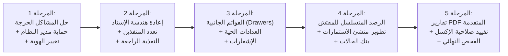

# خطة العمل التنفيذية لتطوير "النظام الإداري لمطاعم المراسيم" (CAPA V2)
### RoadMap & Phased Implementation Plan

تم تصميم هذه الخطة الهندسية لترجمة كافة الملاحظات والتطويرات إلى **5 مراحل تنفيذية دقيقة ومتسلسلة** تضمن استقرار قاعدة البيانات وعدم تعطل بيئة العمل الحالية، وفق مصفوفة الأولويات المتفق عليها:

---

## 🗺️ المخطط العام للمراحل التنفيذية

---

## 🛠️ تفاصيل المراحل التنفيذية

### المرحلة 1: حل المشاكل الحرجة + الأدوار الوظيفية + بنك الحالات والبحث الذكي + صلاحيات الحذف وحماية مدير النظام (الأساس الشامل)
1. **منع تكرار إرسال البلاغ نهائياً (Idempotency Engine):**
   * توليد معرّف عشوائي فريد دائم (`client_uuid`) لكل مسودة يتم إنشاؤها أوفلاين في جهاز المفتش.
   * ضبط الخادم وقاعدة البيانات لمنع حفظ أي بلاغ يحمل نفس المعرّف مرتين، مع قفل زر الإرسال (Debounce / In-flight Lock).
2. **محرك إنشاء وإدارة الأدوار الوظيفية (تعديل - حذف - تعطيل):**
   * إمكانية إنشاء أي دور وظيفي جديد (مفتش عام، مفتش خاص، رئيس قسم، منفذ صيانة، مشرف نظافة، إلخ).
   * إضافة أزرار **التعديل (✏️)**، **الحذف الآمن (🗑️)**، و**التعطيل/التفعيل** لكل دور.
   * ضبط نطاق وصلاحية الدور: تحديد الإدارات التابع لها (أو جميع الإدارات)، وتحديد الأقسام التابع لها (أو جميع الأقسام)، ونوع الصلاحية الأساسية.
3. **بنك حالات عدم المطابقة والتحكم الكامل (تعديل - حذف - تعطيل):**
   * إمكانية إنشاء وتعديل وحذف وتعطيل حالات عدم المطابقة.
   * إضافة أزرار **التعديل (✏️)**، **الحذف (🗑️)**، و**التعطيل/التفعيل** لكل حالة.
   * ضبط صلاحية ونطاق ظهور كل حالة: ربطها بإدارة أو أكثر، وقسم أو أكثر، أو جعلها عامة (خيار "جميع الإدارات / جميع الأقسام").
4. **ميزة البحث الحي الذكي في قائمة الحالات (Searchable Dropdown / Typeahead):**
   * قائمة بحث وتصفية فورية للمفتش أثناء كتابة الحالة؛ بمجرد كتابة أي حرفين (مثلاً: "جو" أو "نظا") تظهر له فوراً الحالات المطابقة للاختيار السريع دون الحاجة للتمرير الطويل.
5. **صلاحية حذف الحالات والبلاغات لمدير النظام (Case Deletion Authority):**
   * تمكين مدير النظام حصرياً من **حذف أي بلاغ أو حالة** في النظام (سواء كانت مفتوحة `pending`، أو معلقة/قيد التنفيذ `assigned`، أو مغلقة `closed`).
   * تنظيف كافة التكليفات والتنفيذات المرتبطة بالبلاغ المحذوف لضمان عدم وجود سجلات يتيمة، مع تسجيل عملية الحذف في سجل التدقيق للأمان والتوثيق.
6. **حماية حساب مدير النظام الأصلي (Super Admin Protection):**
   * جعل حساب مدير النظام الأصلي (الأول في الهيكل) محمياً برمجياً من الحذف أو التعديل أو النقل لأي إدارة، وإبراز شارة الحماية بجانبه.
7. **استحداث دور "المدير العام" (General Manager):**
   * إنشاء دور `general_manager` يملك صلاحيات قيادية كاملة للإسناد ومتابعة كل الإدارات، مع حجب أزرار الحذف النهائي وتصفير النظام التقني.
8. **تحديث الهوية والمسميات الرسمية:**
   * تغيير الاسم الرسمي للمنظومة في كامل واجهات النظام والشاشات إلى: **"النظام الإداري لمطاعم المراسيم"**.
   * استبدال كلمة "مخالفة" بمصطلح **"حالات عدم المطابقة"**.
   * إزالة أي كلمة أو رمز يخص "Kobo" أو "كوبو" من كافة الملفات والشاشات لحفظ الحقوق الفكرية.
9. **إضافة حقل "المسمى الوظيفي" (Job Title):**
   * إضافة عمود `job_title` للمستخدمين مستقلاً عن الدور الوظيفي (مثل: شيف مقبلات، مسؤول صيانة، فني تبريد).

---

### المرحلة 2: إعادة هندسة سير عمل البلاغات وتعدد المنفذين والتغذية الراجعة
1. **الإسناد المتعدد والدقيق بالاسم (Granular Multi-Assign):**
   * تمكين مدير الإدارة عند فرز البلاغ من اختيار منفذ واحد، أو منفذين، أو أكثر بالاسم من قائمة موظفي إدارته.
   * إنشاء سجل تكليف مستقل لكل منفذ تم اختياره.
2. **استمرار ظهور البلاغ عند الجميع حتى القرار الإداري:**
   * عند قيام أحد المنفذين بإرسال الرد والإنجاز، **لا يختفي البلاغ** من زملائه المكلفين، بل تظل الحالة ظاهرة عندهم حتى يبت المدير في الإجراء.
3. **منطق قرارات المدير:**
   * **في حال قبول الإجراء من أحد المنفذين:** تتحول الحالة لدى ذلك المنفذ إلى "المقبولة"، وتبقى مفتوحة لدى الآخرين حتى يتخذ المدير القرار النهائي.
   * **في حال طلب استكمال:** إعادة التكليف لنفس المنفذ أو لمنفذ آخر مع تدوين ملحوظات الاستكمال.
   * **في حال الإغلاق الكامل:** يضغط المدير "إغلاق الحالة بالكامل" ⬅ تختفي الحالة من جميع المنفذين المكلفين وتنتقل لديهم إلى قائمة **"الحالات المغلقة"** مع ظهور الملاحظة الإدارية التي كتبها المدير كـ **(تغذية راجعة إدارية)** للقراءة فقط لمنع تكرار الخطأ.

---

### المرحلة 3: تطوير القوائم الجانبية (Hamburger Drawers) والعدادات الذكية ونظام الإشعارات
1. **القائمة الجانبية للمنفذ الميداني (مع العدادات الحية):**
   * 📥 **الحالات الجديدة** (عدد)
   * 📡 **الجاهزة للإرسال أوفلاين** (عدد)
   * 📤 **الحالات المنفذة** (عدد - للقراءة فقط)
   * 🔁 **الحالات المعادة للاستكمال** (عدد - جولة 2 فأكثر)
   * ✅ **الحالات المقبولة** (عدد - للقراءة فقط)
   * 🔒 **الحالات المغلقة والتغذية الراجعة** (عدد - للاطلاع مع الملاحظة الإدارية)
2. **القائمة الجانبية لمفتش الجودة (مع العدادات الحية):**
   * 🔑 **الخصوصية (تغيير رمز المرور)**
   * ➕ **إنشاء حالة جديدة**
   * 📡 **الجاهزة للإرسال أوفلاين** (عدد)
   * 📤 **الحالات المرسلة** (عدد - للقراءة فقط)
   * ⏳ **الحالات قيد التنفيذ** (عدد - للقراءة فقط)
   * 🔒 **الحالات المغلقة** (عدد - للقراءة فقط)
3. **نظام الإشعارات وتتبع القراءة (Notification Bell):**
   * جرس إشعارات بأعلى كل واجهة يوضح البلاغات والتكليفات الجديدة غير المقروءة، وبمجرد النقر عليها تُعلم كمقروءة وتختفي من التنبيهات غير المفتوحة.

---

### المرحلة 4: الرصد الميداني المتسلسل الذكي وتطوير منشئ الاستمارات وبنك الحالات
1. **مسار الرصد الميداني المتسلسل (Cascading Inspection):**
   * المفتش العام يبدأ باختيار الإدارة ⬅ تظهر فقط الأقسام التابعة لتلك الإدارة ⬅ تظهر فقط حالات عدم المطابقة التابعة للقسم أو الحالات العامة (خيار "جميع الإدارات / جميع الأقسام").
   * المفتش التخصصي تظهر إدارته وأقسامه المخصصة تلقائياً دون تشتيت.
2. **تطوير منشئ الاستمارات الذكية (Dynamic Roles & Users Whitelist):**
   * قراءة الأدوار المنشأة في النظام ديناميكياً بدلاً من القوائم الثابتة.
   * إضافة خيار التحديد الدقيق للمستخدمين المسموح لهم بالاسم (Multi-select Checkboxes) وتخزينها في `allowed_users_json`.
3. **إدارة بنك حالات عدم المطابقة:**
   * واجهة متكاملة لتعديل، حذف، وتعطيل حالات عدم المطابقة، وربط كل حالة بإدارة أو قسم محدد.

---

### المرحلة 5: التقارير المتقدمة PDF والإكسل وصلاحيات التصدير
1. **محرك تقارير PDF المتقدمة:**
   * إمكانية طباعة تقارير احترافية بهوية مطعم المراسيم مفلترة حسب:
     * الفترة الزمنية (من تاريخ ... إلى تاريخ ...).
     * حالة المعاملة (مفتوحة، مغلقة، قيد التنفيذ، معادة).
     * الموظف والمنفذ الميداني أو المفتش.
     * الإدارة والقسم التشغيلي.
2. **تقييد صلاحية تصدير الإكسل والربط الحي:**
   * حجب ظهور رابط وميزة التصدير لـ Excel عن عامة الإداريين، وجعلها صلاحية حصرية يمنحها مدير النظام لأشخاص محددين فقط.
3. **الفحص الشامل والاختبار الميداني:**
   * تجربة المسار الكامل دون إنترنت ومع النت، والتأكد من خلو الخادم من أي أخطاء.

---

## ⏱️ آلية التنفيذ:
سنقوم بتنفيذ الخطة **مرحلة تلو الأخرى**، ومع نهاية كل مرحلة سنقوم باختبارها برمجياً وميدانياً والتأكد من نجاحها 100% قبل الانتقال للمرحلة التالية لضمان أعلى درجات الاستقرار.
