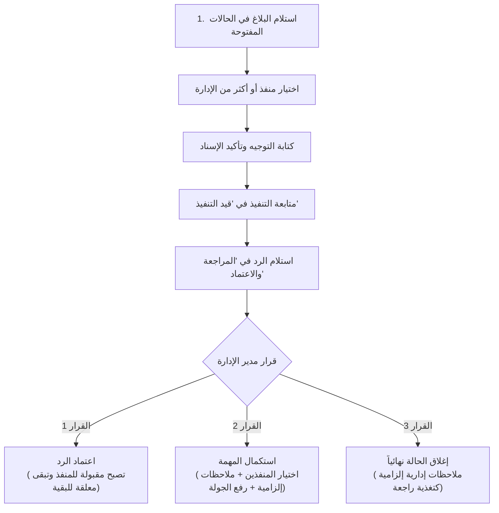

# الدليل الإجرائي والتشغيلي الشامل لمستخدمي منظومة المراسيم (CAPA V2)
### مطعم المراسيم | Al-Marasim Restaurant
**من مدير النظام العام إلى المفتش والمنفذ الميداني**

---

## 📌 الفهرس العام للدليل
1. [مقدمة عن المنظومة وفلسفة العمل](#1-مقدمة-عن-منظومة-حوكمة-الجودة)
2. [دليل مدير النظام العام (Super Admin / General Admin)](#2-دليل-مدير-النظام-العام-super-admin)
3. [دليل مدير الإدارة / المشرف الإداري (Department Admin)](#3-دليل-مدير-الإدارة-department-admin)
4. [دليل مفتش الجودة والراصد الميداني (Quality Inspector)](#4-دليل-مفتش-الجودة-quality-inspector)
5. [دليل المنفذ الميداني (Field Agent / Executor)](#5-دليل-المنفذ-الميداني-field-agent)
6. [جدول المقارنة السريع بين الأدوار والوظائف](#6-جدول-المقارنة-السريع-بين-الأدوار)

---

## 1. مقدمة عن منظومة حوكمة الجودة

منظومة **المراسيم** هي بيئة عمل سحابية وميدانية متقدمة لإدارة الجودة الشاملة وتطبيق المعايير القياسية للإجراءات التصحيحية والوقائية (**CAPA - Corrective and Preventive Actions**).

### المبادئ التشغيلية الحاكمة:
* **الفصل الصارم للمسؤوليات:** المفتش يرصد ولا يسند، والإداري يفرز ويسند ويعتمد، والمنفذ يعالج في الميدان ويوثق.
* **الحماية وسرية الراصد:** حجب هوية المفتش وملاحظاته الحساسة برمجياً عن المنفذ الميداني منعاً لأي احتكاك وظيفي.
* **المرونة وتعدد المنفذين:** إمكانية إسناد البلاغ لعدة منفذين في آن واحد مع متابعة حالة كل منفذ بشكل مستقل.
* **التغذية الراجعة الإلزامية:** لا يمكن إغلاق أي بلاغ دون تسجيل توجيه إداري دائم يظهر للمنفذين كمرجع يمنع تكرار المخالفة.
* **العمل دون اتصال (Offline-First):** استمرار أعمال التفتيش في غرف التبريد والمناطق المعزولة عن الشبكة مع المزامنة التلقائية فور عودة الاتصال.

---

## 2. دليل مدير النظام العام (Super Admin)

مدير النظام هو المسؤول عن ضبط السياسات العامة، وتكوين الهيكل الإداري، والتحكم بكافة صلاحيات المنظومة.

### 🔑 تسجيل الدخول والصلاحيات:
* **بيانات الدخول:** رقم المستخدم الوظيفي (مثال: `101`) + كلمة المرور الخاصة.
* **نطاق الرؤية:** شامل لكافة الإدارات، البلاغات، السجلات، والتقارير.

### 📋 المهام والوظائف الأساسية:

#### أ. التهيئة وإعدادات المنظومة (خاصة بمدير النظام فقط):
1. **إدارة الإدارات المركزية:**
   - الدخول إلى تبويب **"الإدارات والوحدات"**.
   - إضافة إدارة جديدة (اسم الإدارة، كود الإدارة).
   - تعديل بيانات الإدارات القائمة أو تعطيلها.
2. **إدارة الأقسام والمواقع:**
   - الدخول إلى تبويب **"الأقسام والمواقع"**.
   - إضافة قسم جديد وربطه بالإدارة التابعة (مثل: صالة العائلات، مطبخ الساخن، مستودع الجاف).
   - زر خاص بفلترة الأقسام لعرض أقسام إدارة معينة فقط.
3. **تصنيفات حالات عدم المطابقة:**
   - الدخول إلى تبويب **"حالات عدم المطابقة"**.
   - تسجيل المخالفات المعيارية وتحديد درجة الخطورة (عادي، متوسط، عالي ⚠️).
   - ربط المخالفة بإدارة محددة أو اختيار "جميع الإدارات".
4. **محرك النماذج والاستمارات الذكية (Dynamic Forms):**
   - تصميم وتعديل نماذج التفتيش الرقمية.
   - تحديد أسئلة الفحص الميداني، الحقول الإلزامية، وقوائم الاختيار.

#### ب. كادر العمل والمستخدمين وتوزيع الصلاحيات:
1. **إنشاء مستخدم جديد:**
   - يضغط مدير النظام على **"إضافة موظف جديد"**.
   - **الرقم الوظيفي:** يُولّد النظام رقماً تسلسلياً تلقائياً وفريداً لكل موظف (مثل: `101`, `102`, `103`...).
   - إدخال الاسم الرباعي، المسمى الوظيفي، كلمة المرور.
   - تحديد الإدارة التابع لها الموظف.
2. **تحديد الدور والصلاحيات:**
   - **مدير نظام (`super_admin`):** تحكم وصلاحيات كاملة شاملة.
   - **إداري إدارة (`admin`):** محصور في إدارته فقط (فرز، إسناد، مراجعة، إغلاق).
   - **مفتش جودة (`inspector`):** رصد ميداني وتعبئة النماذج.
   - **منفذ ميداني (`field_agent`):** استلام وتنفيذ المعالجات الميدانية.
   - تفعيل أو تعطيل صلاحية تصدير بيانات الإكسل المباشر (`Excel Sync`).

#### ج. الرقابة والتقارير والحساب:
1. **سجل التدقيق الشامل (Audit Trail):**
   - سجل رقمي غير قابل للتعديل يوثق كل حركة بالاسم، التاريخ، الدقيقة، والحالة السابقة والجديدة.
2. **التقارير المتقدمة وطباعة PDF:**
   - استخراج تقارير إحصائية دورية ورسوم بيانية بمعدلات الإنجاز والإغلاق ومؤشرات الأداء.
   - طباعة تقارير رسمية بتنسيق الهوية البصرية لمطعم المراسيم.
3. **تصفير قاعدة البيانات المركزية:**
   - ميزة أمنية محصورة بمدير النظام العام، تتيح تفريغ البلاغات وسجلات الاختبار لبدء دورة تشغيل جديدة.
4. **تغيير الرمز السري (PIN / Password):**
   - واجهة أمنية خاصة بتحديث كلمات المرور لكوادر الإدارة العليا.

---

## 3. دليل مدير الإدارة / المشرف الإداري (Department Admin)

مدير الإدارة هو صمام الأمان التشغيلي المسؤول عن إدارة بلاغات قسمه، وتكليف المنفذين، واعتماد معالجاتهم، والإغلاق النهائي.

### 🔑 تسجيل الدخول والصلاحيات:
* **بيانات الدخول:** رقم المستخدم الوظيفي الخاص بإداري الإدارة + كلمة المرور.
* **نطاق الرؤية:** **محصور بالكامل في إدارته فقط**. لا تظهر له قوائم الإعدادات المركزية ولا كادر المستخدمين العام ولا بلاغات الإدارات الأخرى.

### 📋 المسار الإجرائي اليومي لمدير الإدارة:

#### الخطوة 1: فرز وإسناد الحالات المفتوحة (`الحالات المفتوحة`):
1. يفتح تبويب **"الحالات المفتوحة (بانتظار الفرز)"**.
2. تظهر بطاقة البلاغ موضحاً بها: رقم البلاغ، القسم والموقع، درجة الخطورة، ووصف المخالفة.
3. **اختيار المنفذين الميدانيين:**
   - تظهر للمدير قائمة **منفذي إدارته بالكامل** في مقدمة البطاقة.
   - يمكنه استخدام زر **"تحديد جميع منفذي الإدارة"** بنقرة واحدة، أو اختيار منفذ أو أكثر يدوياً عبر مربعات الاختيار.
   - يوضح النظام عدد المنفذين المحددين لحظياً (مثال: `تم تحديد: 3 منفذين`).
4. **التوجيه الإداري:** كتابة التعليمات المطلوبة في حقل الملاحظات.
5. الضغط على **"تأكيد الإسناد والتكليف الميداني"** ليتحول البلاغ فوراً للمنفذين.

#### الخطوة 2: متابعة الحالات قيد التنفيذ (`الحالات قيد التنفيذ`):
1. يفتح تبويب **"الحالات قيد التنفيذ الميداني"**.
2. يرى المدير ملخصاً حياً لحالة كل منفذ مكلف، مثل:  
   `عبد الحميد الخليدي (completed), الشيف حميد (pending)`
3. تظل الحالة ظاهرة هنا حتى يتم إغلاقها بالكامل.

#### الخطوة 3: مراجعة واعتماد ردود المنفذين (`المراجعة والاعتماد`):
عندما يرفع أحد المنفذين تقرير معالجته، يظهر فوراً في تبويب **"المراجعة والاعتماد"**.  
يمتلك المدير **3 خيارات معتمدة ومحددة**:

* **الخيار الأول: "اعتماد الرد" (Approve Response):**
  - يُستخدم عندما يكون رد المنفذ صحيحاً ومستوفياً.
  - بالضغط على **"اعتماد الرد"**:
    - تتحول حالة التكليف لهذا المنفذ فقط إلى **"مقبولة"**.
    - **لا تختفي الحالة من بقية المنفذين المكلفين**، بل تظل لديهم **"معلقة"** لإتاحة الفرصة لهم بالرد والعمل حتى يتم إغلاق البلاغ نهائياً.

* **الخيار الثاني: "استكمال المهمة" (Continue / Reassign Task):**
  - يُستخدم في حال كان الإجراء غير مكتمل أو يتطلب فريق عمل إضافي.
  - بالضغط على **"استكمال المهمة"** تفتح نافذة مخصصة:
    1. تظهر قائمة بأسماء منفذي الإدارة لاختيار **واحد أو أكثر** أو تحديد الكل.
    2. حقل إلزامي: **"توجيهات وملاحظات استكمال المهمة للمنفذين"** (الزر لا يعمل إذا كان الحقل فارغاً).
    3. الضغط على **"تأكيد إسناد استكمال المهمة"** -> تُرفع جولة البلاغ تلقائياً إلى (Round + 1) وتظهر باللون الأحمر للمنفذين في تبويب "معادة للاستكمال".

* **الخيار الثالث: "إغلاق الحالة نهائياً" (Final Case Closure):**
  - يُستخدم عند انتهاء المعالجة الميدانية ورغبة الإدارة في إغلاق البلاغ بالكامل.
  - بالضغط على **"إغلاق الحالة نهائياً"** تفتح نافذة الإغلاق:
    1. حقل إلزامي: **"الملاحظات والتوجيهات الإدارية الدائمة (تغذية راجعة)"**.
    2. يُلزم النظام الإداري بكتابة التوجيه الإداري لمنع تكرار المخالفة.
    3. بالضغط على **"تأكيد الإغلاق النهائي"** -> تختفي الحالة من القوائم النشطة لجميع المنفذين دفعة واحدة وتنتقل للأرشيف مع توثيق التغذية الراجعة.

---

## 4. دليل مفتش الجودة والراصد الميداني (Quality Inspector)

المفتش هو عين المنظومة في الميدان لرصد وتوثيق حالات عدم المطابقة وفق أعلى المعايير.

### 🔑 تسجيل الدخول والصلاحيات:
* **بيانات الدخول:** رقم المستخدم الوظيفي الخاص بالمفتش + كلمة المرور.
* **نطاق الرؤية:** يرى البلاغات التي رصدها وسجلها بنفسه فقط لضمان التركيز والخصوصية.

### 📋 خطوات رصد وتوثيق المخالفات:
1. **فتح واجهة التفتيش (`/inspector`):**
   - الضغط على **"رصد بلاغ جديد"**.
2. **تعبئة تفاصيل الحالة:**
   - **الإدارة المستهدفة:** اختيار الإدارة المعنية بالمخالفة (مثال: إدارة الإنتاج والجودة الغذائية).
   - **القسم والموقع:** اختيار الموقع الدقيق (مثل: قسم التجهيز، صالة الضيوف، خط الطهي).
   - **حالة عدم المطابقة:** اختيار المخالفة من القائمة المعتمدة مسبقاً.
   - **درجة الخطورة:** تحديد الخطورة (عادي، متوسط ⚡، عالي الخطورة ⚠️).
   - **الوصف الميداني:** كتابة شرح تفصيلي وواضح للواقعة المرصودة.
   - **السبب الجذري المتوقع:** تدوين السبب المرجح (مثل: إهمال العامل، عطل مفاجئ بالمعدة، نقص مواد التعقيم).
   - **إرفاق الصور:** التقاط صورة مباشرة للمخالفة أو رفعها من المعرض.
3. **حفظ وإرسال البلاغ:**
   - بالضغط على **"تسجيل واعتماد البلاغ"**، يُصدر النظام رقماً تسلسلياً فريداً للبلاغ (مثال: `#1024`).

### 📶 ميزة العمل دون اتصال بالإنترنت (Offline Mode):
* في حال تواجد المفتش في مناطق العزل أو غرف التجميد التي لا تصلها الشبكة:
  - يستمر المفتش في كتابة البلاغات والتقاط الصور بشكل طبيعي 100%.
  - تُحفظ البلاغات تلقائياً في **طابور الحفظ المحلي للجهاز (Offline Queue)**.
  - بمجرد عودة الاتصال بالإنترنت، يرسل النظام كافة البلاغات إلى الخادم السحابي ويحدث أرقامها تلقائياً دون أي تدخل يدوي ودون فقدان أي معلومة.

---

## 5. دليل المنفذ الميداني (Field Agent / Executor)

المنفذ الميداني (شيف، فني صيانة، مسؤول نظافة، مشرف تشغيل) هو المسؤول عن تصحيح الأخطاء وتنفيذ التوجيهات في الموقع.

### 🔑 تسجيل الدخول وميثاق الخصوصية:
* **بيانات الدخول:** رقم المستخدم الوظيفي للمنفذ + كلمة المرور.
* **أمان وسرية التفتيش:** محجوب عنه تماماً اسم المفتش أو أي ملاحظات سرية للمفتش، ولا يرى سوى التوجيهات الإدارية ووصف المشكلة.

### 📋 التبويبات الثلاثة في شاشة المنفذ (`/field`):

#### 📥 التبويب الأول: "معالجة بلاغات جديدة" (الجولة 1):
* يحتوي على البلاغات الجديدة التي تم تكليفه بها من قبل مدير الإدارة.
* **حالات البطاقة وظهورها:**
  - **الحالة: معلقة ⏳ (مطلوب اتخاذ الإجراء):** يظهر نموذج إدخال الإجراء التصحيحي.
  - يقوم المنفذ بالعمل الميداني المطلوب.
  - يكتب الإجراء المتخذ في حقل: `🛠️ الإجراء التصحيحي المتخذ ميدانياً (إلزامي)`.
  - يكتب أي ملاحظات إضافية ثم يضغط **"إرسال الإجراء التصحيحي للإدارة"**.
  - **بعد الإرسال:**
    - تتحول البطاقة لديه فوراً إلى:  
      **"الحالة: تم إرسال الرد ⏳ (قيد مراجعة واعتماد الإدارة)"**.
    - تُقفل حقول الإدخال منعاً للازدواجية.
  - **عند اعتماد الإدارة لرده:**
    - تتحول البطاقة إلى اللون الأخضر الزمرّدي:  
      **"الحالة: مقبولة ومعتمدة من الإدارة ✅ (بانتظار الإغلاق النهائي للبلاغ)"**.
    - تظهر له رسالة توجيهية: "تم قبول ردك، وتبقى الحالة معلقة لدى بقية المنفذين المكلفين حتى يتم إغلاقها نهائياً".

#### 🔄 التبويب الثاني: "معالجة بلاغات معادة للاستكمال" (الجولة > 1):
* يحتوي على البلاغات التي رأى مدير الإدارة أنها لم تُعالج بالشكل الكامل أو تحتاج استكمالاً.
* تتميز البطاقة ببرواز أحمر وتنبيه مشدد:  
  `⚠️ تنبيه إعادة إسناد / ملاحظات الإدارة للاستكمال`
* يقرأ المنفذ ملاحظات الإدارة بدقة، وينفذ المطلوب إضافته، ثم يرسل الرد المحدث للإدارة للاعتماد.

#### ✅ التبويب الثالث: "معتمدة ومغلقة (التغذية الراجعة)":
* يحتوي على أرشيف البلاغات التي تم إغلاقها نهائياً من قبل الإدارة بعد التأكد من اكتمال المعالجة.
* **الصندوق التوجيهي الدائم (🔒 للقراءة فقط):**
  - يظهر في كل بطاقة صندوق أخضر بارز يحمل عنوان:  
    `💡 التوجيه والملاحظات الإدارية الدائمة (تغذية راجعة) - 🔒 للقراءة فقط`
  - يحتوي على التوجيه الإداري المكتوب لمنع تكرار هذه المخالفة مستقبلاً، ليكون دليلاً استرشادياً دائماً لكافة المنفذين.

---

## 6. جدول المقارنة السريع بين الأدوار

| الخاصية / الوظيفة | مدير النظام العام | مدير الإدارة | مفتش الجودة | المنفذ الميداني |
| :--- | :---: | :---: | :---: | :---: |
| **واجهة الدخول** | `/admin` | `/admin` | `/inspector` | `/field` |
| **نطاق الرؤية** | المنظومة بالكامل | إدارته فقط | ما رصده فقط | ما كُلف به فقط |
| **إعدادات المنظومة وكادر المستخدمين** | ✅ كامل الصلاحية | ❌ محجوبة | ❌ محجوبة | ❌ محجوبة |
| **رصد بلاغات جديدة** | ✅ متاح | ❌ غير متاح | ✅ الوظيفة الأساسية | ❌ محجوب |
| **إسناد وتوزيع المهام** | ✅ شامل لكل الإدارات | ✅ لمنفذي إدارته فقط | ❌ محجوب | ❌ محجوب |
| **اعتماد الرد الميداني** | ✅ متاح | ✅ متاح لإدارته | ❌ محجوب | ❌ محجوب |
| **استكمال المهمة وإعادة التكليف** | ✅ متاح | ✅ متاح لإدارته | ❌ محجوب | ❌ محجوب |
| **الإغلاق النهائي وتدوين التغذية الراجعة** | ✅ متاح | ✅ متاح لإدارته | ❌ محجوب | ❌ محجوب |
| **تنفيذ المعالجات الميدانية** | ❌ غير مخصص | ❌ غير مخصص | ❌ غير مخصص | ✅ الوظيفة الأساسية |
| **الاطلاع على اسم المفتش** | ✅ ظاهر | ✅ ظاهر | ✅ ظاهر | 🚫 محجوب وسري تماماً |
| **العمل أوفلاين دون إنترنت** | — | — | ✅ مدعوم بالكامل | — |

---
**مطعم المراسيم | قسم إدارة الجودة والحوكمة المؤسسية**  
*تم إعداد وتحديث الدليل ليتوافق مع الإصدار المحدث لمنظومة المراسيم (CAPA V2) لعام 2026*
